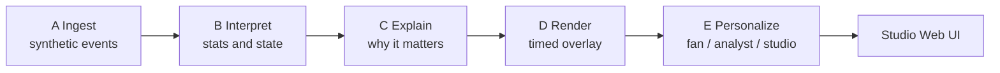
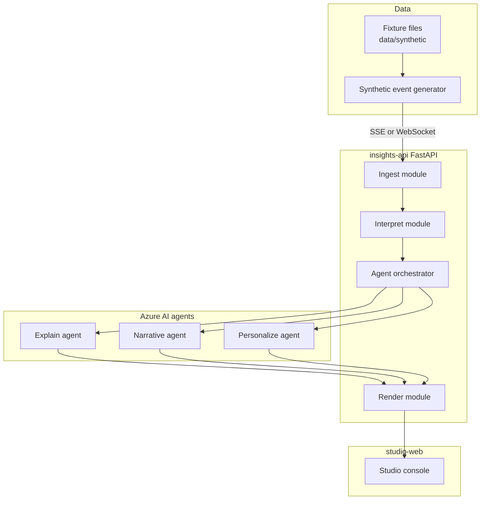
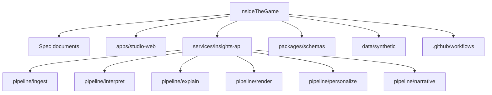
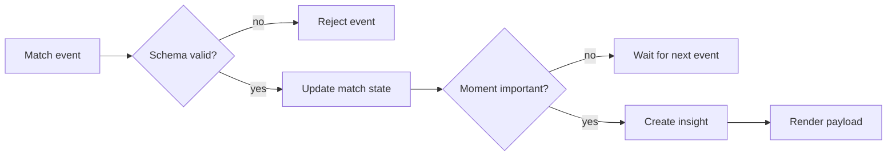
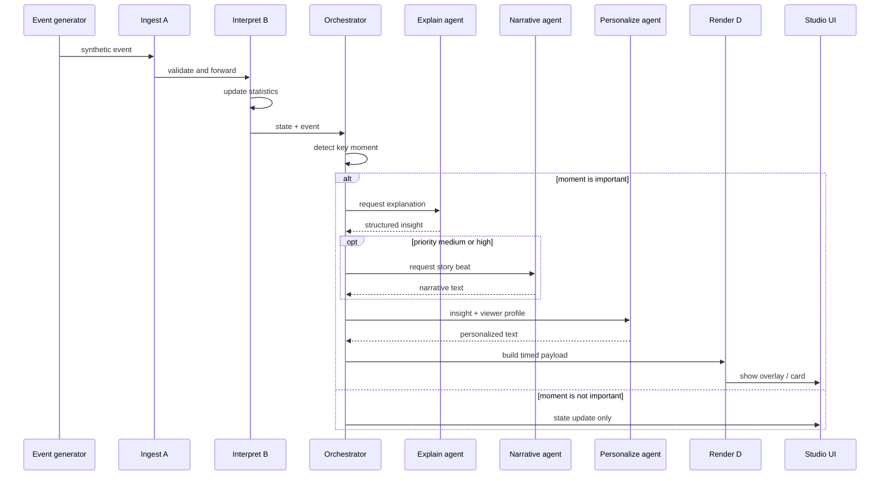
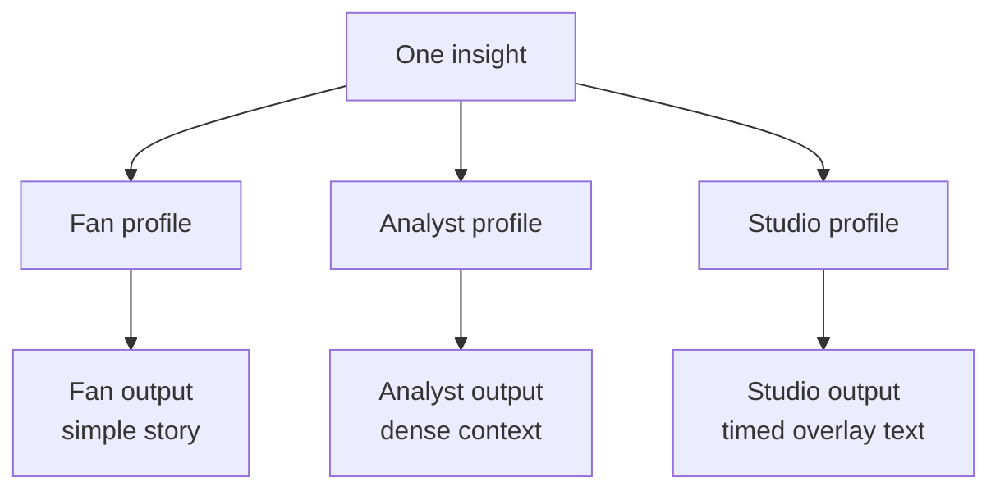
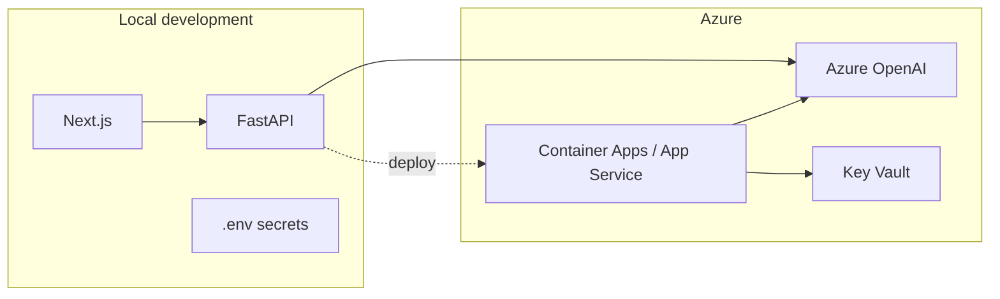
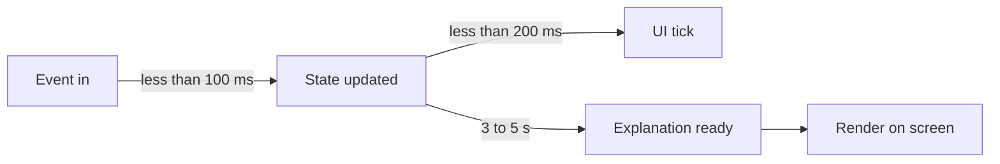
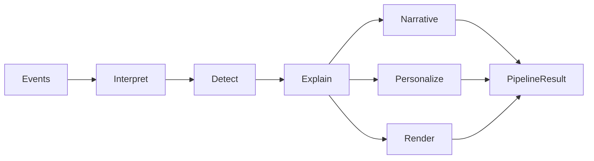

# ARCHITECTURE — Inside the Game

**Language note:** This document uses **ASD-STE100** (Simplified Technical English).  
Sentences are short. Each sentence has one main idea.

---

## 1. Purpose

This system turns **synthetic** football events into match intelligence.  
The intelligence must be clear.  
The intelligence must be timed for studio use.  
The intelligence must adapt for different users.

**Data rule:** Use synthetic football data only.  
Do **not** use real Premier League match data.

---

## 2. System overview

The system has one pipeline.  
The pipeline has five stages.

| Stage | Name | Job |
|-------|------|-----|
| A | Ingest | Receive synthetic match events |
| B | Interpret | Calculate statistics and match state |
| C | Explain | Tell why a moment is important |
| D | Render | Prepare timed output for the screen |
| E | Personalize | Adapt the text for each user type |

**Rule:** Metrics alone are not enough.  
**Rule:** Personalization alone is not enough.  
The system must do both.

### Diagram — high-level flow

### Diagram — main components

---

## 3. Repository layout

The repository has these main parts:

| Path | Contents |
|------|----------|
| `SPEC.md`, `FEATURES.md`, `ARCHITECTURE.md`, `DEMO.md`, `AGENTS.md` | Project rules and plans |
| `.cursor/rules/` | Rules for the coding agent |
| `apps/studio-web/` | Studio user interface |
| `services/insights-api/` | API, pipeline, and agents |
| `packages/schemas/` | Shared data contracts |
| `data/synthetic/` | Synthetic generators and fixtures |
| `.github/workflows/` | Continuous integration |

### Diagram — repository map

---

## 4. Pipeline modules

Each stage has one module.  
Keep the modules separate.

| Stage | Module path | Responsibility |
|-------|-------------|----------------|
| A | `.../pipeline/ingest` | Accept or create events. Publish the stream. |
| B | `.../pipeline/interpret` | Update statistics and match state. |
| C | `.../pipeline/explain` | Make structured “why it matters” insights. |
| D | `.../pipeline/render` | Shape timed overlay payloads. |
| E | `.../pipeline/personalize` | Adapt output by role, club, player, language. |
| + | `.../pipeline/narrative` | Write story beats and match recaps. |

---

## 5. Data contracts

### 5.1 Match event

Every ingested event **must** validate against  
`packages/schemas/match_event.schema.json`.

Required fields:

- `event_id` — unique id  
- `match_id` — match id  
- `seq` — sequence number that increases  
- `match_clock` — clock text, example: `67:12`  
- `period` — `1` or `2`  
- `type` — event type (`pass`, `shot`, `tackle`, `possession_change`, `pressure`, `metadata`, …)  
- `ts` — time in ISO-8601  

Optional fields:

- `team_id`  
- `player_id`  
- `payload` — details for that event type  
- `synthetic` — must be `true`

### Diagram — event to insight

### 5.2 Insight and render payload

Stages C and D create the insight.  
Stage E can change the text for each user.

Required fields:

- `insight_id`, `match_id`, `match_clock`  
- `duration_ms` — how long to show the item  
- `priority` — `low`, `medium`, or `high`  
- `overlay_type` — example: `lower_third`, `moment_card`, `recap_block`  
- `headline`, `body`, `why_it_matters`  
- `evidence` — list of event ids and short labels  

Optional fields:

- `entities` — players or clubs  
- `confidence` — value from 0 to 1  

---

## 6. Agent design

The **orchestrator** controls the loop for each important event.

**Code:** `services/insights-api/app/agents/orchestrator.py`  
**Class:** `MatchIntelligenceOrchestrator`  
**HTTP:** `POST /api/v1/matches/{match_id}/orchestrate`  
**Graph:** `GET /api/v1/orchestrate/graph`

This is a **Semantic Kernel–style process**: explicit steps, swappable Azure OpenAI client on `ExplainAgent`, deterministic interpret/personalize transforms.

### Procedure — agent loop

1. Update the match state with code. Do **not** use a language model for basic statistics.  
2. Use **MomentDetector** rules to decide if the moment needs an explanation.  
3. Call **ExplainAgent** (Azure OpenAI or mock) to create a structured insight.  
4. Call **NarrativeAgent** for story beats (and EN/ES recap at end of run).  
5. Call **PersonalizeAgent** for Fan and Analyst profiles.  
6. Shape **Render** payloads for studio overlays.  

### Diagram — agent sequence

### Responsibility split

| Work | Owner | Reason |
|------|-------|--------|
| Statistics and match state | Deterministic code | Speed, cost, trust |
| Explanation and story text | Language model agents | Language quality |
| Timed overlay shape | Render module | Stable studio contract |

---

## 7. Personalization

A **viewer profile** controls Stage E.

| Field | Meaning |
|-------|---------|
| `role` | `fan`, `analyst`, or `studio` |
| `language` | Language tag (BCP-47) |
| `favorite_club_ids` | Clubs the user follows |
| `favorite_player_ids` | Players the user follows |
| `modes.player_focus` | Optional focus on one player |
| `modes.metric_focus` | Optional focus on one metric |

**Rule:** One insight plus different profiles must create different outputs.  
Do **not** change only colors or layout.  
Change the text and the emphasis.

### Diagram — same insight, different users

---

## 8. Microsoft Azure mapping

| Need | Choice for this hackathon |
|------|---------------------------|
| Language models | Azure OpenAI with structured outputs |
| Agent framework | Semantic Kernel agent pattern |
| API host | FastAPI on Azure Container Apps or App Service |
| Live stream | WebSocket from the API |
| Stretch stream option | Azure Event Hubs |
| Local secrets | `.env` file (do not commit) |
| Cloud secrets | Azure Key Vault in deploy notes |
| Continuous checks | GitHub Actions |

### Diagram — Azure placement

---

## 9. Time limits for the demo

| Path | Target time |
|------|-------------|
| Event to state update | Less than 100 ms |
| Event to UI tick | Less than 200 ms |
| Moment to explained insight | 3 to 5 seconds (async is allowed) |
| Recap generation | On demand, or at the end of the demo |

If the explanation is slow, show an “analyzing” state in the UI.

### Diagram — latency path

---

## 10. Security and compliance

1. Do **not** put real Premier League match data in the repository.  
2. Do **not** commit API keys or `.env` files.  
3. Mark all demo datasets as `synthetic` in the UI and in the README.  
4. Keep public GitHub content clean for hackathon judging.

---

## 11. How to change this architecture

1. Read `SPEC.md` and the active slice in `FEATURES.md`.  
2. Change the design only if the slice needs it.  
3. Update this file in the same change.  
4. Keep diagrams aligned with the code.

---

## 12. Module map (code truth)

| Concern | Path |
|---------|------|
| Ingest + SSE/WS | `app/pipeline/ingest.py` |
| Interpret / state | `app/pipeline/interpret.py` |
| Moment detect | `app/pipeline/moments.py` |
| Explain agent | `app/agents/explain_agent.py` |
| Narrative agent | `app/agents/narrative_agent.py` |
| Personalize agent | `app/agents/personalize_agent.py` |
| Orchestrator | `app/agents/orchestrator.py` |
| Render contract | `app/pipeline/render.py` |
| Studio UI | `apps/studio-web` |
| CI | `.github/workflows/ci.yml` |
| Judge script | `DEMO.md` · `scripts/demo.sh` |

### Diagram — orchestrator process

**End of architecture document.**
