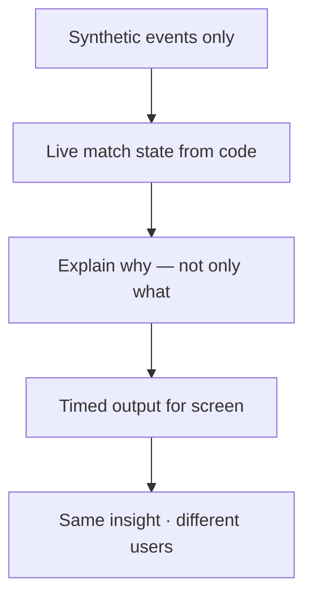
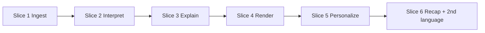
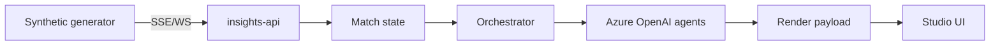
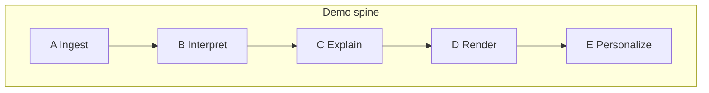

# STUDY GUIDE — Inside the Game (one page)

**Methods used:** 80/20 · First principles · Schematic · Feynman (simple words)  
**Rule:** Ship the demo path. Defer the rest.

---

## 1. Idea in simple words (Feynman)

Football is more than the score.  
We take **fake-but-realistic** match events.  
We turn them into:

1. live numbers  
2. a clear reason a moment matters  
3. text for the studio screen  
4. different words for a fan and for an analyst  

**Code** counts. **AI** explains and rewrites.

---

## 2. First principles (must be true)

| Principle | If you break it… |
|-----------|------------------|
| Synthetic data only | You break the hackathon rule |
| Five stages A→E | Judges cannot see the full story |
| Stats in code, language in AI | Numbers become slow or untrusted |
| Fan ≠ Analyst text | Personalization looks fake |

---

## 3. 80/20 — what to build first

### The useful 20% (must ship)

| Priority | Deliverable | Judge sees |
|----------|-------------|------------|
| P0 | Live synthetic event stream | Events move |
| P0 | Live stats / pressure | State updates |
| P0 | One Azure “why it matters” insight | Explanation |
| P0 | Timed studio card / overlay payload | On-screen shape |
| P0 | Fan vs Analyst on **same** moment | Personalization |
| P1 | Short recap + second language | Narrative / global |

### The other 80% (stretch — only after P0)

- Auto-eventing from video  
- Event Hubs  
- Every metric in the brief  
- Many languages  
- Full CV / speed HUD polish  

---

## 4. Schematic — system

---

## 5. Sticky notes (memorize)

| Note | Text |
|------|------|
| GOAL | Explainable match intelligence for studio + fans |
| DATA | Synthetic only |
| PIPE | Ingest → Interpret → Explain → Render → Personalize |
| SPLIT | Code = stats · AI = why / story / persona |
| PROOF | One moment · two voices (fan vs analyst) |
| STACK | FastAPI · Azure OpenAI · Semantic Kernel · Next.js |
| NEXT | Open `FEATURES.md` · do the next unchecked slice |

---

## 6. Judge 60-second spine

1. Events are live and synthetic.  
2. Stats update from code.  
3. AI explains **why** a moment matters.  
4. Output is timed for studio.  
5. Fan and analyst see different text.  

Full script: `DEMO.md` · Full design: `ARCHITECTURE.md` · Build order: `FEATURES.md`
